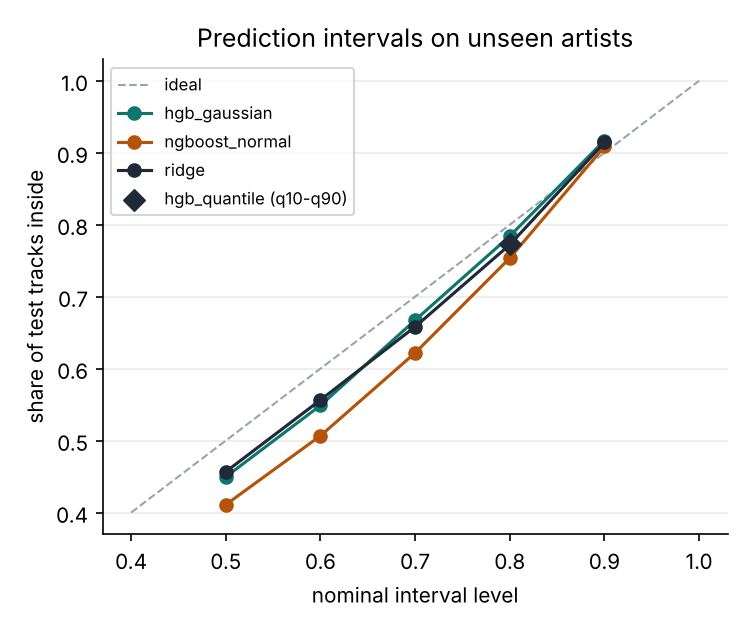
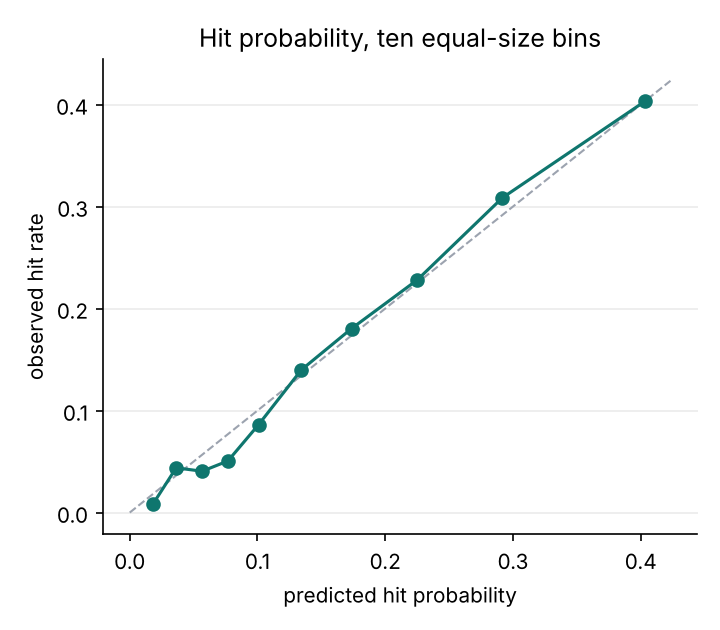
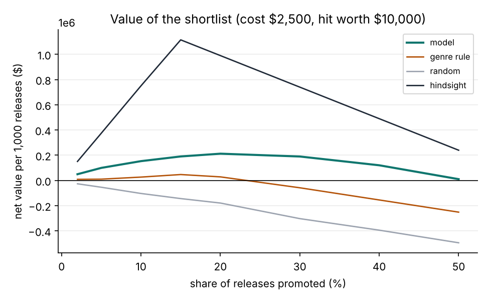
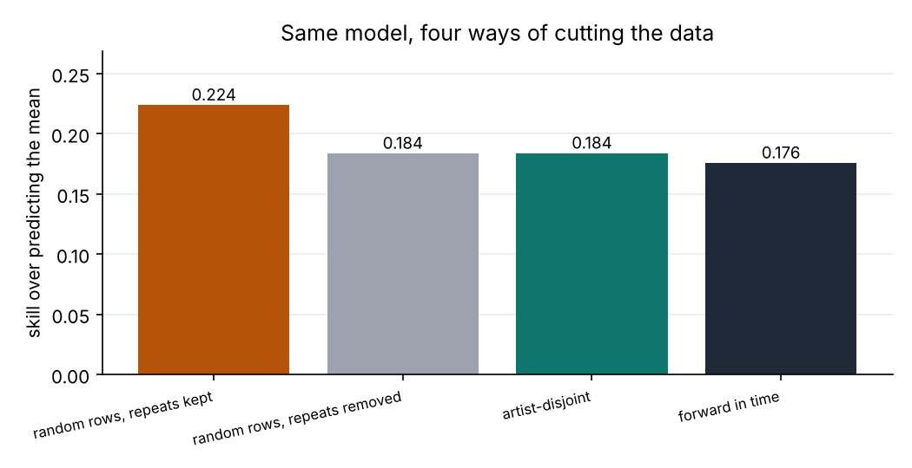
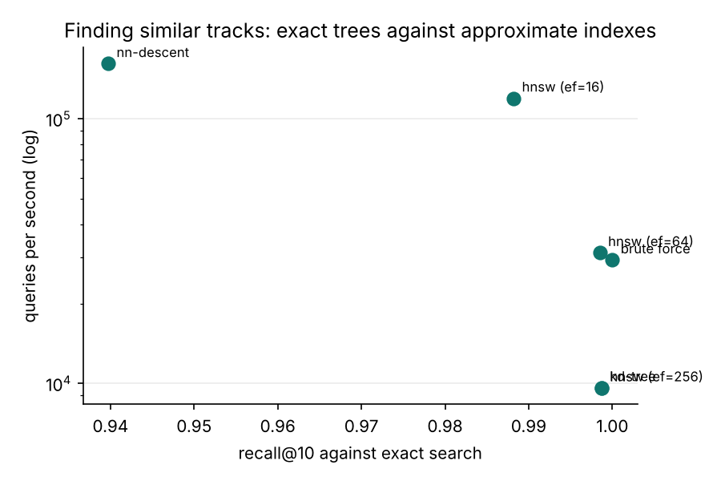

# demoscout

[](https://github.com/ranjithguggilla/demoscout/actions/workflows/ci.yml)

demoscout screens new music releases before any listening data exists. Given only the audio profile, the genre and the release date, it returns an expected popularity, an 80% range around it, the chance of reaching a hit threshold, the five closest tracks already in the catalogue, and a few plain-language reasons. I built it as the kind of tool a label's A&R desk or a playlist team would use to decide which of a month's releases deserve a promotion budget.

The part I cared about most is the validation. Every number below comes from artists the model never saw during training, because a new release from a new artist is the situation the tool exists for. Random row splits flatter this problem, and the audit section shows by how much.

## Results

The data is 28,352 distinct tracks by 10,692 artists. Artists were hashed into train (17,079 tracks), validation (5,346) and test (5,927) so no artist appears in two parts. A "hit" means a popularity score of 65 or more, which is 14.9% of the test tracks.

Audio features alone carry a modest signal. That is the main finding, and the economics below only work because a modest signal is still worth something when the shortlist is small.

### Range models

Each candidate was fitted on the training artists and scored on validation by mean pinball loss at the 10th, 50th and 90th percentiles. The simplest model within one standard error of the best was meant to ship; nothing simpler came close, so the best one did.

| model | validation pinball | test RMSE | test MAE | test pinball | 80% interval coverage | interval width | test CRPS |
|---|---|---|---|---|---|---|---|
| mean only | 5.911 | 23.44 | 19.65 | 5.877 | 0.746 | 61.1 | 13.55 |
| genre mean | 5.774 | 22.87 | 19.13 | 5.721 | 0.754 | 59.8 | 13.19 |
| ridge | 5.625 | 22.32 | 18.64 | 5.583 | 0.772 | 58.1 | 12.85 |
| boosting + constant spread | 5.290 | 21.18 | 17.62 | 5.280 | 0.784 | 54.6 | 12.17 |
| boosting, three quantile models (shipped) | 5.118 | 21.57 | 17.49 | 5.133 | 0.774 | 56.9 | n/a |
| NGBoost, Normal head | 5.237 | 21.27 | 17.74 | 5.241 | 0.754 | 51.7 | 12.14 |

Against predicting the training mean, the shipped model lowers test pinball by 0.744 points (95% interval 0.653 to 0.830, resampling whole artists). Against ridge the gain is 0.451 (0.370 to 0.514). The 80% interval holds 77.4% of test tracks. It falls short mostly because popularity piles up at zero (9.2% of tracks) and a bell-shaped spread does not describe that, which is why NGBoost with its Normal head covers only 75.4%.

CRPS only exists for the models that output a full distribution, so the quantile model has no entry. On the two that do, NGBoost and the boosted model with a constant spread are within 0.03 of each other.



### Hit screen

The hit probability comes from a separate classifier, chosen on validation log loss with the same one-standard-error rule.

| model | test AUC | test log loss | test ECE |
|---|---|---|---|
| base rate | 0.500 | 0.4212 | 0.0076 |
| genre only (logistic) | 0.648 | 0.4005 | 0.0147 |
| logistic on all features | 0.722 | 0.3805 | 0.0121 |
| boosted classifier (shipped) | 0.770 | 0.3603 | 0.0107 |
| NGBoost tail probability | 0.766 | 0.3655 | 0.0288 |

The shipped classifier reaches AUC 0.770 with a 95% interval of 0.749 to 0.790. The ten-bin calibration check is below; the shipped probabilities need no recalibration.



### What it is worth

The economics rest on two numbers I made up, so treat them as inputs: a promoted release costs $2,500, and a promoted release that turns out to be a hit brings $10,000 of incremental net revenue. Break-even precision is therefore 25%. The shortlist size (30% of releases) was chosen on validation, then applied once to test.

| policy | share of list that were hits | net per 1,000 releases | 95% interval |
|---|---|---|---|
| shipped hit screen | 31.3% | $189,809 | $87,349 to $290,455 |
| genre hit rate only | 23.1% | -$58,208 | -$170,214 to $50,035 |
| random shortlist | 14.9% | -$302,851 | -$374,616 to -$236,679 |
| hindsight (knows the outcome) | n/a | $739,835 | n/a |

The model beats the genre rule by $248,018 per 1,000 releases (167,168 to 325,745). The test curve peaks near a 20% shortlist ($212,165), a little earlier than the 30% validation picked, so the choice cost some value.



The result is sensitive to the assumptions. At $7,500 per hit and $2,500 per promotion the screen loses $45,132 per 1,000 releases; at $10,000 and $4,000 it loses $260,165; at $15,000 and $4,000 it earns $209,718. The full grid is in `outputs/tables/economics_sensitivity.csv`.

### Audit: how much of the number is real

The same boosted model scored under four ways of cutting the data. Skill is the share of mean-only squared error removed, so it compares across splits.

| protocol | test rows | RMSE | skill |
|---|---|---|---|
| random rows, repeat playlist rows kept | 6,547 | 22.11 | 0.224 |
| random rows, repeats removed | 5,662 | 21.55 | 0.184 |
| artist-disjoint (used for everything above) | 5,927 | 21.18 | 0.184 |
| forward in time (train before mid-2018, test from late May 2019) | 5,976 | 19.74 | 0.176 |



Keeping the repeat rows (the same track listed on several playlists) adds about four points of skill. Nothing about the model improved.

Adding each artist's average popularity as a feature drops RMSE to 19.92 on a random split, where 71% of test tracks belong to a known artist. On the artist-disjoint split no test track has a known artist and the same feature gives 22.00, which is worse than the 21.18 without it. A tool for debut releases cannot lean on artist history.

Feature blocks, scored on the same test artists:

| features | RMSE | skill |
|---|---|---|
| all | 21.18 | 0.184 |
| without release year | 22.08 | 0.113 |
| without genre | 21.72 | 0.142 |
| release year and genre only | 21.91 | 0.126 |
| audio only | 22.60 | 0.071 |

Release year is the strongest single input (permuting it raises test pinball by 0.610, genre by 0.286, loudness 0.115, instrumentalness 0.100, energy 0.072, danceability 0.028). Part of that is a snapshot effect: the popularity scores were collected at one moment, and recent releases score higher on average, which says something about the data collection and not about the music. Audio alone gets 0.071 skill. I would not claim more than that.

Group checks on the test artists show the model is decent in every genre and era but not uniform. EDM hits are rare (4.2% observed against 4.0% predicted) and its 80% interval covers only 70.7%. Releases from 2019 on have the lowest error (RMSE 17.1) while 2015 to 2017 has the highest (23.7).

### Similar-track search

Finding comparable tracks is a nearest-neighbour problem in 11 standardised audio dimensions. I benchmarked exact and approximate indexes on the 17,079 training tracks with 3,000 test queries, k = 10, and recall measured against exact brute force.

| index | build time (s) | queries per second | recall@10 |
|---|---|---|---|
| brute force | 0.001 | 29,289 | 1.0000 |
| kd-tree | 0.024 | 9,642 | 0.9987 |
| HNSW, ef 16 | 1.76 | 119,687 | 0.9882 |
| HNSW, ef 64 | 1.71 | 31,209 | 0.9985 |
| HNSW, ef 256 | 1.84 | 9,620 | 0.9987 |
| NN-Descent | 24.66 | 161,641 | 0.9397 |

At this catalogue size brute force is already fast and exact. HNSW at ef 64 is only slightly faster for the same recall, and NN-Descent costs 25 seconds to build and loses 6% of the true neighbours. The app uses a kd-tree, which is exact and builds in milliseconds. The approximate indexes would matter at a few million tracks, not at seventeen thousand. As a predictor, the mean popularity of the 20 nearest tracks gives RMSE 23.17, barely better than the 23.44 of predicting the mean.



Timings come from a 2-core machine and will differ on yours. Recall values will not.

## Architecture

```
 spotify_songs.csv
        |
        v
  data.py  -- clean, parse dates, drop repeat playlist rows, hash artists into splits
        |
        +--> models.py   six range models, four hit models (preprocessing inside each)
        |        |
        |        v
        |   pipeline.py  fit on train, pick on validation (one-SE rule), score once on test
        |        |
        |        +--> metrics.py    pinball, CRPS, interval score, ECE, artist bootstrap
        |        +--> audit.py      split protocols, artist encoding, feature blocks, groups
        |        +--> neighbors.py  brute force / kd-tree / HNSW / NN-Descent benchmark
        |        +--> economics.py  shortlist value under stated cost assumptions
        |        +--> plots.py      charts in assets/
        |
        v
  outputs/scout.joblib  (range model + hit screen + catalogue + kd-tree)
        |
        v
  scoring.py  -->  app.py (gradio)  : range, hit chance, reasons, closest tracks
```

## Installation

Python 3.11 or newer. I developed on 3.13.

```
git clone https://github.com/ranjithguggilla/demoscout.git
cd demoscout
python -m venv .venv && source .venv/bin/activate
pip install -r requirements.txt
pip install -e . --no-deps
```

For the tests and linter, also run `pip install -r requirements-dev.txt`.

## Usage

1. Download the data (about 8 MB). `demoscout run` does this automatically if the file is missing.

   ```
   demoscout fetch
   ```

2. Run the full pipeline: selection, test scoring, audits, neighbour benchmark, economics, charts and the saved bundle. It takes about two minutes on two cores.

   ```
   demoscout run
   ```

3. Open the screener.

   ```
   demoscout app
   ```

4. To score a release from Python:

   ```python
   import joblib
   scout = joblib.load("outputs/scout.joblib")
   out = scout.score({"playlist_genre": "pop", "danceability": 0.8, "energy": 0.7, "release_year": 2019.9})
   print(out["expected_popularity"], out["low_80"], out["high_80"], out["hit_probability"])
   print(out["reasons"])
   print(out["similar"])
   ```

   Fields you leave out default to the typical training release.

## Configuration

Command line options for `demoscout run`:

| option | default | meaning |
|---|---|---|
| `--data` | `data/spotify_songs.csv` | csv location, fetched if absent |
| `--out` | `outputs` | metrics, tables and the bundle |
| `--assets` | `assets` | chart output folder |
| `--seed` | 0 | artist hash seed, model seeds and bootstrap seed |
| `--boot` | 300 | artist-level bootstrap resamples |

Economic assumptions live at the top of `src/demoscout/economics.py` (`COST` and `VALUE_HIT`). The hit threshold is `HIT_THRESHOLD` in `src/demoscout/data.py`. The app's verdict cut-offs (`BASE_RATE`, `SHORTLIST_CUT`) are in `src/demoscout/app.py`.

## Output structure

```
outputs/
  metrics.json                 every number quoted above
  scout.joblib                 saved screener (not committed)
  tables/
    range_models_test.csv      range model comparison on test
    hit_models_test.csv        hit classifier comparison on test
    split_protocols.csv        four validation protocols
    artist_encoding.csv        artist-mean leakage check
    feature_blocks.csv         ablations
    permutation_importance.csv
    group_audit.csv            by genre and era
    neighbor_search.csv        index benchmark
    value_curve.csv            net value by shortlist share
    economics_sensitivity.csv  value and cost grid
assets/                        charts used in this readme
```

## Project structure

```
src/demoscout/
  data.py        loading, cleaning, three kinds of split
  models.py      range and hit candidates
  metrics.py     scoring rules and artist-level bootstrap
  audit.py       leakage and ablation studies
  neighbors.py   nearest-neighbour index benchmark
  economics.py   shortlist value
  scoring.py     scoring one release, reasons, similar tracks
  pipeline.py    end-to-end run
  plots.py       charts
  app.py         gradio screener
  cli.py         command line
tests/           pytest suite on a small synthetic table
data/            download location and source note
.github/workflows/ci.yml
```

## Technical details

Preprocessing (scaling the numeric columns, one-hot genre) sits inside each model, and every model is fitted on training artists only. The constant spread for the Gaussian-style models comes from five-fold out-of-fold residuals on the training rows, so it is not tuned on validation or test.

The shipped range model is three boosted models trained with pinball loss at 0.1, 0.5 and 0.9, sorted per row so quantiles never cross. NGBoost uses depth-3 trees with a Normal head and 400 rounds at learning rate 0.03.

Model choice uses the one-standard-error rule: the simplest model whose validation loss is within one standard error of the best. The standard error is row-level, which slightly understates the uncertainty because tracks by one artist are correlated. Test intervals avoid that problem by resampling whole artists.

Reasons are produced by swapping one feature at a time to the training median (or most common genre) and reporting how far the predicted median moves. This ignores interactions between features, so I describe it as what moves the estimate and not as a causal explanation.

The popularity column is a single snapshot from when the data was collected and it counts plays up to that moment, so release year and popularity are linked partly through data collection. The genre is the genre of the playlist a track was found on, which is a curated label and would have to be supplied by whoever screens a release.

After the test numbers were recorded, the shipped models were refitted on train plus validation for the saved bundle. The bundle's numbers were not re-measured, since no held-out artists remain.

## Testing

```
pip install -r requirements-dev.txt
ruff check .
pytest -q --cov=demoscout
```

The suite runs on a synthetic table with a planted signal, so it needs no download. It covers the splits (no artist overlap, stable under row order), every model's output shape and quantile ordering, that preprocessing never sees held-out rows, scoring rules against hand-computed values, the artist bootstrap, the economics arithmetic, the audit studies, the screening function behind the app, and a complete pipeline run on the small table. 35 tests pass and coverage is 96%.

## Dataset credit

Spotify songs data from the TidyTuesday project, collected with the spotifyr package by Charlie Thompson, Josiah Parry, Donal Phipps and Tom Wolff.
https://github.com/rfordatascience/tidytuesday/tree/main/data/2020/2020-01-21

## License

MIT. See `LICENSE`.
